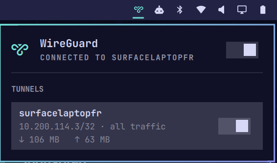

# WireGuard for Omarchy

A bar widget for WireGuard tunnels managed by NetworkManager. See tunnel state
at a glance, toggle it from the bar or a keybinding, and read the tunnel's
address, routing mode and live transfer without ever entering a password.



Omarchy ships a Tailscale widget but nothing for plain WireGuard. If your tunnel
comes from a Firewalla, pfSense, OPNsense, UniFi, or a `wg` server you run
yourself, this fills that gap.

## Requirements

- Omarchy with the Quickshell shell (`omarchy-shell`)
- NetworkManager 1.16 or newer — WireGuard support is built into NetworkManager
  itself
- At least one WireGuard connection **managed by NetworkManager**

`wireguard-tools` is **not** required, and neither is `wg-quick`. Tunnels run by
`wg-quick` or its systemd unit are invisible to this widget, which only sees
NetworkManager connections.

## Install

```bash
omarchy plugin add https://github.com/studylamp/omarchy-wireguard.git --enable
```

Plugins land disabled by default so you can read the code first; drop `--enable`
if you would rather review before switching it on, then:

```bash
omarchy plugin enable io.github.studylamp.wireguard
omarchy bar move io.github.studylamp.wireguard --section right
```

## Remove

```bash
omarchy plugin remove io.github.studylamp.wireguard
```

That deletes the plugin directory and drops it from the bar layout. It does not
touch your WireGuard connections — they are NetworkManager's, not the widget's.
If you added the optional keybinding below, delete that line from
`~/.config/hypr/bindings.lua` as well.

## Adding a tunnel

Import the `.conf` your VPN server gives you:

```bash
nmcli connection import type wireguard file ~/Downloads/hometunnel.conf
nmcli connection modify hometunnel connection.autoconnect no
```

Two things that trip people up:

- **The filename must be a valid network interface name plus `.conf`** — at most
  15 characters, no spaces. `hometunnel.conf` works; `My_Home_VPN_Profile.conf`
  is rejected outright. The connection is named after the file, so rename it
  before importing to choose the label.
- **Delete the `.conf` afterwards.** It contains your private key, and
  NetworkManager has already copied it into
  `/etc/NetworkManager/system-connections/`.

Importing activates the tunnel immediately unless you turn autoconnect off.

## Interactions

| Action | Result |
|---|---|
| Left click | Open the panel |
| Right click | Toggle the primary tunnel |
| Middle click | Refresh now |

In the panel: `j`/`k` or arrows move the cursor, `enter`/`space` toggles the row
under it, `t` toggles the primary tunnel, `r` refreshes, `esc` closes.

## Optional keybinding

```lua
-- ~/.config/hypr/bindings.lua
o.bind("SUPER + SHIFT + V", "WireGuard toggle",
  os.getenv("HOME") .. "/.config/omarchy/plugins/io.github.studylamp.wireguard/toggle.sh")
```

`toggle.sh` flips the primary tunnel and raises a notification with the result.
Check `omarchy menu keybindings --print` for a conflict before picking a combo.

## What it shows

The bar icon is dim when every tunnel is down and accent-coloured when any is
up. Each panel row shows the tunnel name, its address, whether it carries all
traffic or is a split tunnel, and live transfer counters. Inactive rows show the
configured endpoint instead.

## The primary tunnel

Right click, `t`, and the keybinding all act on the *primary* tunnel. With no
preference set that is whichever tunnel is currently up, otherwise the first
one. Pin a specific tunnel by name or UUID:

```bash
omarchy bar set io.github.studylamp.wireguard primary hometunnel
```

## Settings

| Key | Default | Meaning |
|---|---|---|
| `refreshIntervalSec` | `5` | Poll interval, 2–3600 seconds |
| `primary` | `""` | Tunnel name or UUID for the quick toggle; blank means auto |

## Privileges

The widget needs none. It never runs as root, installs no sudo rule, and
triggers no polkit prompt in normal use.

`wg show` is deliberately unused, because it requires root — everything
displayed here is readable unprivileged:

| Data | Source |
|---|---|
| Tunnel list and active state | `nmcli connection show` |
| Address and routes | `nmcli device show` |
| Endpoint and allowed IPs | `nmcli connection show uuid <uuid>` |
| Transfer counters | `/sys/class/net/<iface>/statistics/` |

Private keys are never read. Peer configuration is queried without
`--show-secrets`, so preshared keys stay out of the widget entirely.

Bringing a tunnel up or down calls `nmcli connection up`/`down`, which
NetworkManager's default polkit policy permits for active local sessions.
On a system with a stricter policy those two actions may prompt; nothing else
will.

Because the widget only ever reads, it never modifies your NetworkManager
connections or your Omarchy config. Enabling it adds a bar entry, and that is
the only file it causes to change.

## Files

| File | Role |
|---|---|
| `Panel.qml` | Bar widget and popup panel |
| `Service.qml` | Polling, optimistic toggle state, `nmcli` actions |
| `Model.js` | Parsing and formatting; no Qt dependencies |
| `poll.sh` | One-shot state dump — run it directly to see what the widget sees |
| `toggle.sh` | Keybinding entry point |

Debugging starts with `bash poll.sh`: it prints the exact blob the widget
parses, so a wrong reading in the panel is usually obvious there first.

## License

MIT — see [LICENSE](LICENSE).
